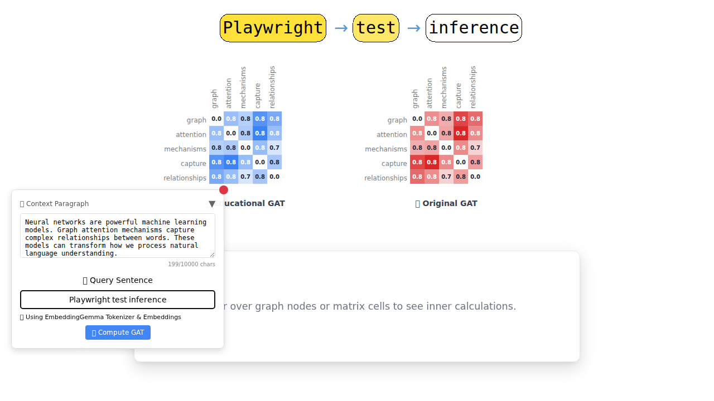

# TextGraph — Dual Graph Attention & Token Embeddings

## 🌐 [Live Demo](https://1kaiser.github.io/TextGraph/)

Interactive in-browser visualization comparing **Scaled Dot-Product Attention** and **Original Multi-Head Graph Attention Networks (GAT, Veličković et al., ICLR 2018)** over shared contextualized token vectors computed in a Web Worker using **Transformers.js v4.3.2**, **D3.js v7**, **KaTeX**, and **Vue 3**.



## 🎯 Architecture & Verified Mathematical Pipeline

- **Non-Blocking Web Worker Token Embeddings**:
  - Renders immediately with a `64D` deterministic lexical baseline while neural weights load in the background (`env.useBrowserCache = true`).
  - Supports **Xenova/all-MiniLM-L6-v2** (`384D`, ~23 MB WASM `q8`), **Xenova/bge-small-en-v1.5** (`384D`, ~34 MB WASM `q8`), and **onnx-community/embeddinggemma-300m-ONNX** (`768D`, WebGPU `q4` `model_no_gather` / WASM `q8`).
  - Encodes the **Context Paragraph + Query Sentence** together, extracts `last_hidden_state`, aligns subwords back to query words via token decoding, mean-pools per word, and L2-normalizes each vector $\vec{h}_i \in \mathbb{R}^d$.
- **Dual Attention Comparison over Shared $\vec{h}_i$**:
  - **2A. Educational Scaled Dot-Product Attention**: $\alpha_{ij}^{\text{dot}} = \text{softmax}_{j \in \mathcal{N}_i}\!\left(\frac{\vec{h}_i \cdot \vec{h}_j}{\tau}\right)$ with adjustable temperature $\tau$ and toggleable self-loops.
  - **2B. Original Multi-Head GAT (Veličković et al., ICLR 2018)**: Xavier-seeded projection $\mathbf{W}^{(k)} \in \mathbb{R}^{32 \times d}$ and attention vector $\vec{a}^{(k)} \in \mathbb{R}^{64}$ across $K \in \{1, 2, 4\}$ heads:
    $$\alpha_{ij}^{(k)} = \text{softmax}_{j \in \mathcal{N}_i}\!\left(\text{LeakyReLU}_{0.2}\!\left(\vec{a}^{(k)T}[\mathbf{W}^{(k)}\vec{h}_i \,\|\, \mathbf{W}^{(k)}\vec{h}_j]\right)\right)$$
  - Supports neighborhood masks (`full`, Distill sequential window $|i-j| \le 1$, and local window $|i-j| \le 2$), full-precision softmax (`Σ = 1.00`), synchronized Token Graph ↔ Dual Matrix hover & click-to-pin, and KaTeX cell-level tensor heatmaps.

## 🚀 Quick Start & Build

```bash
npm install
npm run dev       # Vite dev server (http://localhost:1234)
npm run build     # Production build in dist/
```

## 📚 References & Attributions
- Veličković, P., Cucurull, G., Casanova, A., Romero, A., Liò, P., & Bengio, Y. (2018). *Graph Attention Networks*. ICLR ([arXiv:1710.10903](https://arxiv.org/abs/1710.10903)).
- Sanchez-Lengeling, B., Reif, E., Pearce, A., & Wiltschko, A. B. (2021). *A Gentle Introduction to Graph Neural Networks*. *Distill* ([doi:10.23915/distill.00033](https://doi.org/10.23915/distill.00033)).
- Vaswani, A. et al. (2017). *Attention Is All You Need*. *NeurIPS* ([arXiv:1706.03762](https://arxiv.org/abs/1706.03762)).
- [Xenova/all-MiniLM-L6-v2](https://huggingface.co/Xenova/all-MiniLM-L6-v2), [Xenova/bge-small-en-v1.5](https://huggingface.co/Xenova/bge-small-en-v1.5), [EmbeddingGemma-300M](https://huggingface.co/onnx-community/embeddinggemma-300m-ONNX), and [Transformers.js](https://huggingface.co/docs/transformers.js).
- Visualization Stack: [Vue 3](https://vuejs.org/), [D3.js v7](https://d3js.org/), and [KaTeX](https://katex.org/).
- Part of [1kaiser.github.io](https://1kaiser.github.io/).
